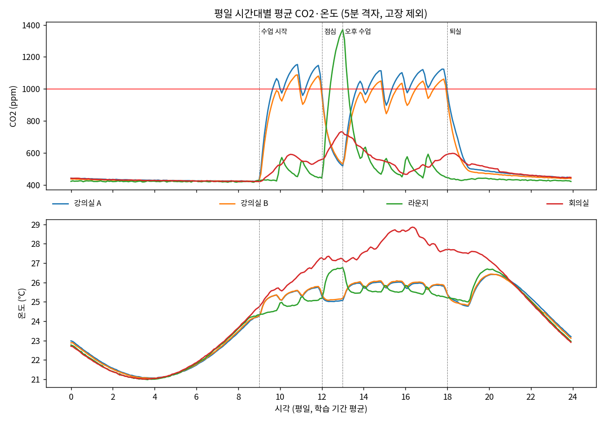
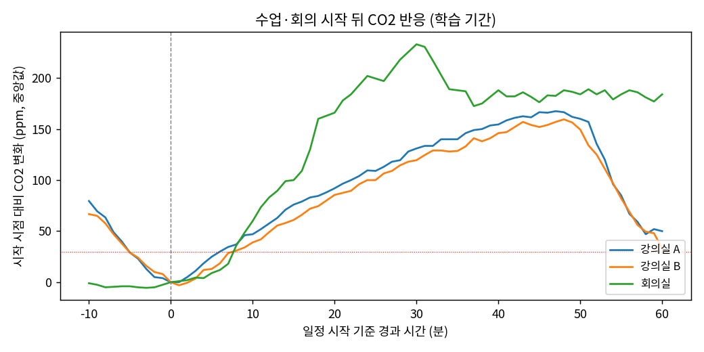
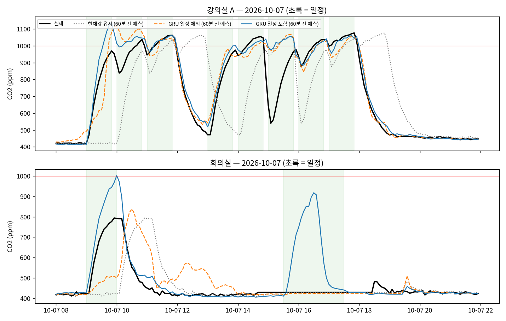
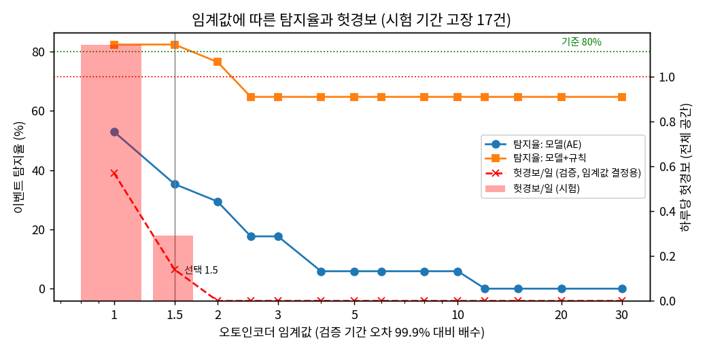

# 시계열 데이터 추론 실습 — 결과 보고서 (team2, 기본 트랙)

## 0. 요약

### 측정 조건 (모든 표에 공통, 다르면 표 아래에 따로 적음)

| 항목 | 값 |
|---|---|
| 합성 데이터 | **팀 자체 생성기**(제공 키트가 없어 과제 안내문 규칙대로 작성), seed 42, 2026-08-31 ~ 10-11 (6주), 강의실 A·B, 회의실, 라운지. 결측·깨진 값·잡음 포함, **시험 주간에 고장 5종 17건** |
| 기간 분할 | 학습 08-31 ~ 09-27 (4주) / 검증 09-28 ~ 10-04 / **시험 10-05 ~ 10-11** (평가 전용) |
| 실데이터 | 교육장 LoRaWAN 센서 12대(실습실·사무실·사무실 밖·회의실). 실시간 2026-10-20 10:21 ~, 과거 2025-08 ~ (운영진 DB에서 읽기 전용 토큰으로 이관, 2,751만 건) |
| 보드 | Jetson Orin Nano Super 8GB(CPU·GPU 공유, 스왑 없음), L4T R39.2.1, **전력 모드 25W**, 클럭 고정 안 함 |
| 소프트웨어 | PyTorch 2.11(CUDA 13), TensorRT 10.16, ONNX Runtime 1.31, InfluxDB 2.7, Mosquitto 2 |
| 평가 시점 | 과제 2에서 고정한 5분 단위 시점(시험 7,690개). 과제 3~6 모두 같은 시점. 주 성적은 **고장 앞뒤 60분 제외** |

### 확인 기준 총괄

| 과제 | 확인 기준 | 결과 |
|---|---|---|
| 1 수집 | 브로커 재시작 후 1분 안에 재개 / 재부팅 후 자동 재개 / 24시간 커버율 95% | 0.6초 ✅ / 2회 ✅ / 다중 센서 공간 96~100% ✅, 단일 센서 공간은 정의상 한계(1.4절) △ |
| 2 기준선 | 학습 기간 정규화 / 같은 시점 비교 / 가장 강한 기준선 설명 | ✅ / ✅ / 현재값 유지 ✅ |
| 3 예측 | 60분 CO₂ 30% 이상 개선 / 온도 개선 / 시험 미사용 | **−60%** ✅ / −66% ✅ / ✅ |
| 4 이상 탐지 | 탐지율 80% / 헛경보 하루 1회 이하 / 못 잡는 종류 설명 | **82%** ✅ / **0.29회** ✅ / ✅ |
| 5 상태 추정 | 사용 여부: 규칙보다 우수, 빈 방 오판 보고 / 환기: 재현율 85%, 규칙보다 macro-F1 높음 | F1 0.842 vs 0.657, 오판 0.2% ✅ / 0.860, 0.873 vs 0.786 ✅ |
| 6 사전학습 | 같은 시점 비교 / 정확도·구간·시간·메모리 근거 | ✅ / ✅ (조건부 보조 채택) |
| 7 엣지 | CO₂ 차이 1ppm 이하 / 분류 변화 0.1% 이하 / 조건 기록 | **0.71ppm** ✅ / **0%** ✅ / ✅ |
| 8 서비스 | 12시간 무중단 / 수집기 10분 정지 시 경보·복귀 / API / 형식 문서 | 10-21 09:45 가동 중(21:45 판정) ⏳ / ✅ / ✅ / ✅ |

---

## 1. 데이터 수집 체계

**구성**: ChirpStack → MQTT → **수집기(Docker)** → InfluxDB(Docker). 둘 다 `restart: unless-stopped`이고 Docker는 부팅 시 자동 시작한다. 수집기는 **고정 client_id + 영속 세션 + QoS 1**로 접속해서, 끊긴 동안의 메시지를 브로커가 보관했다가 다시 넘겨준다. `deduplicationId`로 재전송 중복을 제거한다.

### 1.1 복구 시험

| 시험 | 결과 |
|---|---|
| 수집기 네트워크 60초 차단 | 복구 2초 뒤 재연결. 실패한 DB 쓰기는 메모리에 보관했다가 재시도해 유실 0 |
| **브로커 정지 30초 → 시작** (우리 브로커 svc-mosquitto, 10-21 10:37) | **시작 0.6초 뒤 재연결**(이전 세션 유지), 데이터 매분 연속 |
| **보드 재부팅 2회** (10-20 10:25, 15:33) | 부팅 23·21초 뒤 MQTT 재연결, **공백 약 45·44초**, 사람 손 없이 재개 |

### 1.2 24시간 수집 현황 (2026-10-20 10:21 ~ 10-21 10:21, 실데이터)

| 공간 | 센서 수 | CO₂ 1분 커버율 | 온도 1분 커버율 | 습도 1분 커버율 |
|---|---|---|---|---|
| 실습실 | 8 | 96.0% | **100%** | **100%** |
| 사무실 | 2 | 98.9% | 99.4% | 99.4% |
| 사무실 밖 | 1 | — | 77.8% | 77.8% |
| 회의실 | 1 | 9.6% | 9.6% | 9.6% |

**센서별 수신률**(받은 건수 ÷ 그 센서 보고 주기로 기대되는 건수)은 12대 중 11대가 **96.5~104.5%**였다. 1대(EM500-CO2-152862)는 보고 간격이 1~7분으로 불규칙해 62%로 계산됐다.

### 1.3 결측 구간과 원인

| 시각 | 길이 | 원인 | 데이터 유실 |
|---|---|---|---|
| 10-20 10:25 | 45초 | 재부팅 시험 1 | 없음 |
| **10-20 11:39** | **약 5분** | `nvidia-jetpack` 설치 중 NVIDIA 스크립트가 **Docker를 Docker CE로 교체**하며 수집기 컨테이너 정지 | **없음** — 브로커가 보관 후 재전송(실습실 온도 100%) |
| 10-20 15:33 | 44초 | 재부팅 시험 2 | 없음 |
| 10-20 16:47 | 약 1분 | 과제 6 Chronos-base 평가 중 **메모리 부족으로 보드 응답 정지**, MQTT 연결 끊김 | 없음 |
| 회의실 여러 번 | 15~25분 | 회의실 센서는 **10분 주기** → 1~2회 무선 수신 실패(LoRa) | 해당 측정 1~2건 |
| 10-21 09:16 | 수 초 | 수집기 이미지 재빌드(버그 수정, 1.5절) | 없음 |

### 1.4 커버율 95% 판정

- **센서가 여러 대인 공간(실습실·사무실)은 96~100%로 충족**한다.
- 회의실은 센서가 **10분마다** 보내서 "1분 칸 커버율"이 정의상 10%를 넘을 수 없다(실제 수신률 96.5%). 사무실 밖은 약 1분 주기 센서 1대라 보고 시각이 흔들리면 한 분에 2건·다음 분 0건이 되어 77.8%가 된다(수신률 97.8%). **두 공간 모두 수집 실패가 아니라 센서 보고 주기 때문이다.**
- 그래서 운영 지표로는 **센서 보고 주기 기준 수신률**을 함께 본다.

### 1.5 메시지 형식이 바뀌는 상황 — 실제 대응 사례

과제 8에서 합성 데이터를 **ChirpStack이 아닌 평평한 JSON**(`{"ts", "room", "co2", "temp", "humidity"}`)으로 보내야 했다. **코드는 그대로 두고 설정 파일만 새로 써서** 같은 수집기 이미지를 하나 더 띄웠다.

```yaml
sources:
  - topic: sim/sensors/+          # 토픽
    time: ts                       # 측정 시각 필드
    tags: { location: room }       # 공간 태그
    outputs:
      - measurement: env
        fields_from: ""            # 최상위 숫자 값 전부
        rename: { temp: temperature }
        exclude: [ ts, room ]
```

이 과정에서 **중복 제거 키가 없는 형식에서는 메시지 전체를 키로 써서 오류가 나는 버그**를 발견해 고쳤다(키가 있을 때만 검사). 설정 기반 설계라도 **새 형식은 실제로 한 번 돌려 봐야** 한다는 교훈이다.

### 1.6 생각해 볼 점

- **어떤 시각을 저장하나**: 센서(LoRa Class A)에는 시계가 없어서 **게이트웨이가 받은 시각**(메시지의 `time`)을 저장한다. 수집기가 받은 시각을 쓰면, 네트워크가 30초 밀렸다가 한꺼번에 도착할 때 측정들이 같은 시각에 몰린다. 실제로 11:39 정지 뒤 5분치가 한꺼번에 들어왔지만 원래 시각으로 저장되어 1분 칸이 모두 채워졌다.
- **수집과 학습·추론이 같은 저장소를 쓰면**: 무거운 조회가 쓰기를 늦추거나 DB를 멈출 수 있다. 실제로 운영진 DB에 전체 기간 조회를 보냈을 때 **서버 오류(500)**가 났다. 그래서 학습은 **Parquet 고정본**에서 읽고, 과거 데이터 조회는 **월 단위**로 나누고, 서비스는 **최근 4시간만** 읽는다.

---

## 2. 데이터 이해와 기준선 (합성)

### 2.1 정제 규칙 (`/srv/team/common/preprocess.py`, 학습·서비스 공용)

| 대상 | 규칙 | 이유 | 결과 |
|---|---|---|---|
| 불가능한 값 | CO₂ 300~5,000 / 온도 5~45 / 습도 1~100 밖 → 결측 | 외기 420ppm 미만 불가, 0·65535는 오류 값 | CO₂ 75, 온도 83건 제거 |
| 중복 | 같은 공간·시각은 첫 값만 | 재전송 | 합성 0건 (실데이터 주당 약 2,100건) |
| 기록 주기(1·2·5분) | **5분 칸 평균**, 칸 t = [t−5분, t) | 라운지가 5분 주기 | — |
| 짧은 결측 ≤15분 | **직전 값으로 채움** | 선형 보간은 미래 값이 필요해 서비스에서 재현 불가 | 칸의 0.2~0.7% |
| 긴 결측 >15분 | 채우지 않고 제외 | 가짜 값 학습 방지 | 9건(20~355분) |
| 고장 구간 | 학습·정규화에서 제외, 평가는 제외·포함 둘 다 | 이상 탐지는 정상만 배워야 함 | — |

**분석 간격 5분**: 가장 긴 기록 주기와 같고, 과제 3의 출력 간격과 같으며, 잡음이 줄고(σ 8 → 3.6ppm), CO₂ 반응(6~8분)을 놓치지 않는다.
**시간순 분할**: 5분 사이 CO₂ 변화가 평균 13ppm뿐이라, 무작위로 섞으면 시험 시점 바로 옆이 학습에 들어가 '외워서' 맞힌다.
**정규화(학습 기간만)**: CO₂ 523.5 ± 213.3ppm, 온도 24.29 ± 2.84℃, 습도 56.73 ± 5.94%.

### 2.2 진단



*그림 1. 평일 시간대별 평균 CO₂·온도 (학습 기간, 고장 제외). 강의실은 수업마다 톱니 모양으로 11시대 평균 1,150ppm까지 오르고, 점심·퇴실에 떨어진다. 라운지는 점심에 1,370ppm.*



*그림 2. 수업·회의 시작 뒤 CO₂ 변화 (학습 기간, 중앙값).*

| 공간 | 30ppm 오르기까지 | 일정 중 상승 폭 | 끝난 뒤 절반까지 |
|---|---|---|---|
| 강의실 A / B | **6분 / 7분** | 177 / 173ppm | 4.5 / 5분 |
| 회의실 (60m³) | **7.5분** | **362ppm** | 12분 |

**일정과 실제가 어긋난 날**: 일정 동안 CO₂가 40ppm도 안 오른 일정 21건 중 16건이 실제로 빈 방이었다(놓친 것 0건). **강의실 B 09-15 하루 종일 휴강**, 회의실 노쇼 8건, 예정 밖 회의실 사용 4건(모두 정답과 일치). 시험 주간에는 **강의실 B 10-06 종일 비어 있음**.

### 2.3 기준선 (시험, 고장 제외, MAE)

| 기준선 | CO₂ 5 / 15 / 30 / **60분** (ppm) | 온도 60분 (℃) |
|---|---|---|
| **현재값 유지** | 10.2 / 19.7 / 30.2 / **45.3** | **0.86** |
| 최근 1시간 평균 | 27.1 / 33.0 / 40.8 / 54.0 | 1.21 |
| 어제 같은 시각 | 91.8 / 92.1 / 93.0 / 94.8 | 1.31 |

- **현재값 유지가 가장 강하다**: CO₂는 5분 사이 평균 13ppm만 변한다. 1시간 평균은 오르는 중에 늘 한 박자 늦다.
- **어제 같은 시각이 가장 약한 이유**: 휴강(10-06 강의실 B → 그날과 다음 날 오차 263~279ppm), 요일 경계(토 138, 월 128ppm), 전날 고장이 옮겨 옴(라운지 일요일 240ppm). 다만 **예측 거리가 길어져도 오차가 늘지 않아**, 시간표가 매일 같은 공간이나 몇 시간 앞 예측에서는 강해질 수 있다.

---

## 3. 60분 예측

| 설계 | 선택 |
|---|---|
| 입력 | 과거 2시간(24칸) CO₂·온도·습도 + 결측 표시 / 시각·요일·공간 / **과거 2시간 + 앞으로 60분의 일정(진행 여부, 예상 인원)** |
| 출력 | 5~60분 12칸 × (CO₂, 온도) **한 번에**, **지금 값에서의 변화량** |
| 모델 | GRU 2층(64) + MLP, L1 손실, 검증 손실로 조기 종료, **시드 3개 평균** |

| 모델 (시험, 고장 제외) | CO₂ 5 / 15 / 30 / **60분** | 온도 60분 |
|---|---|---|
| 현재값 유지 | 10.2 / 19.7 / 30.2 / 45.3 | 0.86 |
| GRU 일정 제외 | 7.2 / 12.0 / 17.1 / 24.3 ± 0.4 | 0.29 |
| **GRU 일정 포함 (채택)** | **6.5 / 9.2 / 12.6 / 18.0 ± 0.4** | **0.29** |
| GRU 일정 포함, 절댓값 예측 | 10.4 / 12.0 / 14.2 / 19.7 ± 2.0 | 0.38 |

| 공간 (60분 CO₂) | 현재값 유지 | 일정 제외 | 일정 포함 | **일정 효과** |
|---|---|---|---|---|
| 강의실 A / B | 46.2 / 66.1 | 22.7 / 25.6 | 17.7 / 20.5 | −5.1 / −5.1ppm |
| 라운지 | 43.9 | 22.7 | 18.2 | −4.5ppm |
| **회의실** | 27.4 | **26.3** | **15.8** | **−10.5ppm (−40%)** |

> **일정 정보를 넣으면 60분 CO₂ 예측 오차가 24.3 → 18.0ppm으로 6.4ppm(26%) 줄고, 회의실에서는 40% 줄어든다.**



*그림 3. 시험 기간 10-07, 60분 전에 낸 예측과 실제. 회의실 15:30~17:30은 센서 값 고정 고장 구간이다.*

- **회의실은 과거 센서값만으로는 예측하지 못한다**(일정 제외 26.3 ≈ 현재값 유지 27.4). "언제 회의가 시작되는가"는 센서가 아니라 **예약 시스템**에 있다.
- **오차가 가장 큰 순간은 일정 시작 1시간 전 ~ 시작 직후**다(회의실 127ppm, 평소 4~10ppm). 일정을 알아도 실제 인원(노쇼 15%, 지각)은 모른다.
- **변화량 vs 절댓값**: 변화량 예측이 짧은 시점에서 훨씬 정확하다(5분 6.5 vs 10.4ppm). 절댓값은 외기 수준으로 돌아가는 구간만 조금 낫고 시드별로 불안정하다.
- 그림 3의 회의실 15:30: 모델은 예약을 보고 상승을 예측했는데 센서는 평평했다. **"예약은 있는데 CO₂가 안 오른다"는 예측 오차가 고장 신호**다(과제 4로 연결).

---

## 4. 이상 탐지

| 탐지기 | 대상 | 기준 (학습 기간 정상 데이터로 결정) |
|---|---|---|
| **조건부 오토인코더** | 맥락이 필요한 설비 고장 | 2시간 창을 시각·공간·일정 조건으로 복원. 점수 = 최근 30분 오차 ÷ 검증 99.9%, **1.5 초과** |
| 규칙: 튄 값 | 튄 값 | 1분 원본이 직전 중앙값에서 크게 벗어났다 **바로 복귀** (평소 최대 이탈 × 1.5) |
| 규칙: 값 고정 | 값 고정 | CO₂·온도가 같은 값으로 **30분** 이상 (평소 최대 10분) |
| 규칙: 평소 최고치 초과 | 환기 정지 | 5분 CO₂ > 공간별 학습 99.9% × 1.1 |
| 규칙: 새벽 기준선 | 영점 틀어짐 | 00~05시(빈 방) CO₂가 30분 넘게 새벽 최고치 + 100ppm 위 |

임계값은 **검증 기간(고장 없음)에서 모델 헛경보 하루 0.5회 이하**가 되는 가장 낮은 값으로 정했다.

| 고장 (시험) | 건수 | 모델 | 규칙 | **결합** | 결합 평균 지연 |
|---|---|---|---|---|---|
| 튄 값 | 6 | 1 | 5 | **5** | 1분 |
| 값 고정 | 3 | 1 | 2 | **2** | 29분 |
| 영점 틀어짐 | 2 | 1 | 2 | **2** | 380분 |
| 냉방 정지 | 3 | **3** | 0 | **3** | 43분 |
| 환기 정지 | 3 | 0 | 2 | **2** | 64분 |
| **합계** | 17 | 35% | 65% | **82%** | 77분 |

**하루당 헛경보 0.29회**(7일간 2건, 모두 모델). 규칙 4종은 검증·시험 모두 헛경보 0건.



*그림 4. 오토인코더 임계값에 따른 탐지율과 헛경보. 1.0이면 헛경보가 하루 1.14회로 기준을 넘고, 2.0이면 냉방 정지 1건을 놓쳐 76%가 된다.*

- **놓친 3건**: ① 라운지 튄 값 — 라운지는 5분마다 기록하는데 **튄 값이 기록 사이에 생겨 데이터에 남지 않음** ② 라운지 값 고정 — **게이트웨이 끊김과 겹쳐 기록 0건**(데이터 끊김 경보가 대신 울림) ③ 회의실 환기 정지 — 인원이 적어 평소 범위 안.
- **모델이 못 잡는 것**: 튄 값(5분 평균에서 희석), 정상 범위에서 멈춘 값(그럴듯하면 복원 오차가 작음), 환기 정지("사람이 많은 날"과 구별 불가). **규칙이 못 잡는 것**: 냉방 정지(천천히 오르고, 튀지도 멈추지도 않음 — "이 시각엔 냉방이 돌아야 한다"는 맥락이 필요).
- **원인 가리키기**: 규칙은 정확히 해당 항목을 가리킨다. 모델은 냉방 정지 3건 중 2건에서 **습도를 1순위**로 가리켰다. 냉방이 꺼지면 제습도 멈춰 습도가 먼저 흔들리기 때문이다. 경보에는 상위 2개 항목을 보여 준다.
- **운영 제안**: 튄 값은 기록만(하루 3회 이상이면 데이터 담당), 값 고정·새벽 기준선은 센서 담당, 평소 최고치 초과는 **해당 강의실 + 시설팀 즉시**, 모델 경보(냉방 정지)는 시설팀. 회의실은 평소 점수가 높아(검증 99.9%: 1.65) 임계값 2.0.

---

## 5. 상태 추정

**직접 관찰**: 합성 데이터라 사람이 관찰할 수 없어서, 시험 주간 공간마다 하루 3번 1시간씩 무작위 관찰을 가정하고 정답 인원으로 관찰 기록을 만들었다(814칸). 실데이터에서는 실제 관찰 기록이 이 자리에 들어간다.

### 5.1 사용 여부 (입력: 센서 변화만 — 일정·시각 제외)

| 방법 (관찰 814칸) | 정확도 | F1 | **빈 방 → 사용중 오판** |
|---|---|---|---|
| 일정 그대로 (참고) | 0.886 | 0.752 | 9.2% |
| 규칙: 15분 +30ppm | 0.886 | 0.657 | 1.1% |
| **모델 (MLP)** | **0.941** | **0.842** | **0.2%** |

- **일정 기반 정답은 11.4%가 틀린다**(일정 있는데 빈 방 59칸, 일정 없이 사용 34칸). **그 틀린 정답으로 학습했는데 모델이 일정 자체보다 실제를 더 잘 맞힌다.** 일정을 입력에 넣지 않아 일정의 우연한 오류 대신 물리적 흔적을 배웠다. 일정을 입력에 넣으면 "일정 = 사용중"만 외워 정작 찾아야 할 노쇼·휴강을 하나도 못 잡는다.
- **가장 많이 헷갈리는 경우**: **들어온 직후 15분**(오류 37%, CO₂ 반응 6~8분). 막 나간 직후는 "높지만 내려가는 중"이라는 모양으로 구별한다(0.8%, 규칙은 12%).
- **큰 강의실에 5명 이하는 구별 불가**(재현율 0%): 270m³에서 5명이 만드는 상승은 잡음 수준이다. 공간이 클수록 감지 가능한 최소 인원이 커진다.

### 5.2 환기 선제 경보 (양성: 지금 < 1,000이고 30분 안에 ≥ 1,000, 시험 양성 1.6%)

| 방법 (시험) | 정확도 | 재현율 | macro-F1 |
|---|---|---|---|
| 한 번도 안 울림 | **0.984** | 0 | 0.496 |
| 규칙: 현재 ≥ 850ppm | 0.984 | 0.664 | 0.786 |
| **분류 모델** (기준 0.96, 검증 재현율 88%로 선택) | 0.991 | **0.860** | **0.873** |
| 과제 3 예측 모델 (같은 시점 6,345개) | 0.995 | **0.897** | **0.931** |

- 정확도는 의미가 없다(안 울려도 98.4%). **이미 넘은 시점은 정답에서 뺐다** — 넣으면 "지금 넘었으니 곧 넘는다"가 양성을 채워 미리 알리는 능력이 평가되지 않는다.
- **재현율 우선**: 놓치면 졸음·두통, 헛경보의 비용은 "창문을 몇 분 일찍 연다" 정도다.
- **예측 모델이 분류기보다 낫다** → 서비스는 **예측 모델 하나로 예측과 환기 경보를 함께** 낸다.

---

## 6. 사전학습 모델 (Chronos-Bolt, 추가 학습 없음)

| 모델 (과거 길이: 검증으로 선택) | 60분 CO₂ MAE | 10~90% 구간 적중률 (목표 80%) | GPU 지연 (배치 1) | 메모리 증가 |
|---|---|---|---|---|
| Chronos-Bolt tiny (일주일) | 40.9ppm | 69.1% | 38ms | 0.7GB |
| Chronos-Bolt small (일주일) | 31.5ppm | 76.0% | 48ms | 0.9GB |
| Chronos-Bolt base (일주일) | 29.4ppm | **80.0%** | 89ms | 1.4GB |
| **GRU 직접 학습 (일정 포함)** | **18.0ppm** | 구간 없음 | **0.9ms** | **0.2GB** |

*비용 측정 중 팀원 작업이 CPU를 사용 중이었음(GPU 지연은 영향 작음).*

- **과거를 길게 줘야 한다**: 2시간이면 현재값 유지보다 나쁘고(53~56ppm), 일주일이면 학습 없이 35% 좋아진다. 시각·요일을 모르니 과거 안에서 반복을 찾아야 한다.
- 같은 2시간 과거에서 GRU(일정 제외)와의 차이 약 30ppm은 **시각·요일·온습도**의 몫, 일정 포함과의 추가 6ppm은 **일정**의 몫이다.
- **실제 사고**: base에 일주일 과거를 넣어 평가하는 동안 **보드가 약 5분 응답 정지**(스왑 없음). 로컬 LLM(2~3GB)과 base를 함께 상주시키는 것은 불가능하다.
- **채택 의견**: 주 모델은 GRU. **Chronos-Bolt small을 보조로 조건부 채택** — 학습 데이터가 없는 새 공간(실데이터 공간을 처음 붙일 때)과 불확실성(확률 경보)이 필요할 때만 올렸다 내린다. base는 상주시키지 않는다.

---

## 7. 엣지 최적화 (25W, 클럭 고정 안 함, 워밍업 30회, 블록당 3초, 부하 0.06)

| 모델 | PyTorch CPU | PyTorch GPU | **ONNX Runtime CPU** | TensorRT FP16 |
|---|---|---|---|---|
| 예측 GRU | 10.62 / 11.82 | 1.10 / 1.14 | **0.21 / 0.23** | 1.27 / 1.37 |
| 예측 TCN (지연 비교용) | 1.66 / 2.06 | 2.14 / 2.31 | **0.12 / 0.12** | 0.62 / 0.67 |
| 이상 탐지 AE | 1.26 / 1.50 | 1.13 / 1.16 | **0.047 / 0.048** | 0.47 / 0.49 |
| 분류 MLP (2종) | 0.49~0.52 | 0.64 | **0.027** | 0.38 |

*단위 ms, 배치 1 평균 / p95, 호스트 입력 → 호스트 결과 전체. 배치 4도 거의 같음.*

| 변환 결과 차이 (PyTorch CPU 대비) | 결과 |
|---|---|
| GRU, TensorRT FP16 전부 | CO₂ 최대 **1.31ppm ❌** |
| **GRU, FP16 + 출력 MLP만 FP32 (채택)** | CO₂ 최대 **0.71ppm ✅**, 속도 동일 |
| GRU, GRU 일부만 FP32 | **290ppm — 결과가 깨짐** |
| AE / 사용 여부 / 환기 경보 (FP16) | 판정·분류가 바뀐 비율 **0%** ✅ |

- **작은 모델에서는 ONNX Runtime CPU가 가장 빠르다**: GPU 복사·실행 고정 비용(약 0.35ms)이 계산보다 크다. 다만 연속 실행 전력은 가장 높다(GRU 10.1W vs TensorRT 7.2W, 대기 5.8W).
- **TCN은 TensorRT로 3.5배 빨라지고 GRU는 안 빨라진다**: 합성곱은 시간축 병렬, GRU는 24칸을 차례로 계산한다.
- **FP16 오차가 213배로 커지는 이유**: 모델이 내는 정규화 변화량을 CO₂ 표준편차(213ppm)로 곱해 ppm으로 바꾼다. 출력 MLP만 FP32로 두면 해결된다. 반대로 **GRU 내부 일부만 FP32로 묶으면 결과가 깨졌다** — 빌드 성공 ≠ 결과 정상, 실제 입력 검증이 필수다.
- **느린 쪽 5%가 중요한 이유**: 매분 마감이 있는 서비스는 가끔 크게 늦는 것이 문제다. 보드를 같이 쓰면 꼬리 지연이 먼저 나빠진다(과제 6 응답 정지).

---

## 8. 상시 추론 서비스 v1

**구성**: 합성 시험 주간을 **현재 요일·시각에 맞춰 재생**(고장 17건 포함) → 우리 MQTT 브로커(:1885) → 수집기-sim(과제 1 수집기 + 설정 파일만 다름) → InfluxDB → **추론 서비스(systemd, 매분 15초)** → MQTT 발행(retain) + **조회 API(:8091)** + 이력(InfluxDB). 실데이터 공간은 데이터 끊김 감시만 한다. 결과 형식: `/srv/team/service_kit/INTERFACE.md`.

| 요구 | 구현 / 결과 |
|---|---|
| 매분 공간별 계산 | 60분 예측, **"몇 분 뒤 1,000ppm 초과"**, AE 점수·원인 상위 2개, 규칙 경보 6종, 사용 여부, 환기 선제 경보. **1주기 0.37~0.59초** |
| MQTT (새 구독자 즉시 수신) | 상태·경보·실데이터·서비스 상태 **retain** — 익명 새 구독자가 **13개 토픽을 즉시 수신**. 익명 발행 거부(ACL). 서비스 비정상 종료 시 `online:false`(LWT) 확인 |
| 조회 API | `/health`, `/spaces`, `/spaces/{space}`, `/spaces/{space}/forecast?minutes=30`, `/alerts`, `/events`, `/real`, `/docs` |
| **학습과 같은 전처리** | 학습 함수를 그대로 import. **159개 시점에서 입력 차이 0**, 예측 차이 0.038ppm |
| 계산 1회 실패 | 09:47 일부러 실패 → **09:48 정상** |
| **수집기 10분 정지** | 09:58~09:59 `data_gap` 경보(원인 추정 "수집기 정지") → 재시작 **49초 뒤 해제**, 정지 중 데이터 **유실 0**(브로커 보관) |
| 재부팅 자동 시작 | systemd `enabled`, Docker `unless-stopped` (서비스 포함 재부팅 시험은 남음) |
| 경보 중복 방지 | 처음 1번(raised) → 30분마다(reminder) → 해제 1번(cleared). 상태를 파일에 저장해 재시작 후에도 유지 |
| **12시간 가동** | **10-21 09:45 시작**, 21:45 이후 `summary_12h.py`로 주기별 처리 시간·경보 내역·실패 집계 |

- **운영 판단**: 같은 보드에서 팀원 학습(최대 2.8GB)·팀원 서비스가 함께 돌아 여유 메모리가 1.3GB 이하로 떨어졌다. TensorRT는 CUDA 런타임 때문에 서비스가 1.2GB를 쓰고, ONNX Runtime은 약 0.4~0.7GB를 쓴다. 과제 7에서 ONNX Runtime이 이 모델들에서 가장 빨랐으므로 **ONNX Runtime으로 운영**하고, 설정 한 줄로 TensorRT로 바꿀 수 있게 했다.
- **막 시작된 5분 칸은 쓰지 않는다**: 학습 때 칸은 항상 5분치였다. 1~2분치 평균은 잡음이 크고, 오르는 구간에서 낮게 나온다. 결과는 최대 5분 늦지만 규칙(끊김 등)은 원본을 바로 본다.
- **로컬 LLM이 도구로 쓰려면**: 지금은 기준 시각·단위·불가 이유 문장이 있다. 더 필요한 것은 예측 구간, 권장 행동, 경보 요약 엔드포인트다.

---

## 9. 가장 의외였던 발견 (발표용)

1. **틀린 정답으로 배운 모델이 정답보다 정확했다.** 일정 기반 정답은 11%가 틀렸는데, 센서만 본 모델은 일정 자체보다 실제 사용을 더 잘 맞혔다(F1 0.842 vs 0.752).
2. **냉방 고장을 모델은 '습도'로 먼저 알아챘다.** 냉방이 멈추면 제습도 멈춘다.
3. **놓친 고장 3건 중 2건은 데이터에 아예 없었다.** 5분 기록 사이에 생긴 튄 값, 게이트웨이 끊김과 겹친 값 고정. 탐지기보다 센서 기록 주기가 한계였다.
4. **작은 모델은 GPU보다 CPU가 빠르다.** TensorRT보다 ONNX Runtime CPU가 5~14배 빨랐고, 같은 크기라도 TCN은 3.5배 빨라졌지만 GRU는 그대로였다.
5. **가장 위험한 것은 모델이 아니라 메모리였다.** 사전학습 모델 하나가 보드를 5분간 멈췄고, 같은 보드를 쓰는 작업들 때문에 서비스 실행 방식을 바꿔야 했다.

## 10. 한계와 다음 단계

- 합성 데이터는 팀 자체 생성기라 실제 교육장과 다를 수 있다. 실데이터 3주가 쌓이면(과거 15개월 이관분 포함) 같은 파이프라인으로 재학습한다. 실데이터 공간은 일정 자료가 필요하다.
- '직접 관찰'은 가정이다. 실데이터에서 실제 관찰 기록을 만들어야 한다.
- 클럭 고정(`jetson_clocks`)과 스왑 추가는 sudo가 필요해 하지 않았다. **스왑 추가를 권장한다.**
- 남은 시험: 서비스 포함 재부팅, 12시간 기록 요약(21:45 이후).
- 심화(B) 과제는 이후 진행한다.

---

### 부록: 결과 위치 (`/srv/team`)

| 과제 | 경로 |
|---|---|
| 1 | `ingest/` (수집 스택, README 복구 기록), `ingest/out/coverage24_*.csv` |
| 2~7 | `task2/` ~ `task7/` 각 `REPORT.md`, `out/` |
| 8 | `service/` (서비스, 장애 시험, 요약), `service_kit/` (키트, `INTERFACE.md`, 일치 시험) |
| 공통 | `common/preprocess.py`, `data/` (합성, 과거 원본 Parquet) |
