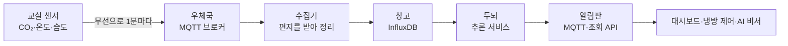

# 처음 보는 사람을 위한 안내서

> 이 문서는 데이터 분석이나 인공지능을 몰라도 이 프로젝트가 **무엇을, 왜, 어떻게** 했는지 이해할 수 있도록 쓴 안내서입니다.
> 수식과 코드는 거의 없고, 비유와 그림 위주로 설명합니다. 자세한 숫자와 근거는 [결과 보고서](00_결과보고서.md)에 있습니다.

---

## 1. 한 문장으로

> **교실 공기 센서 값만 보고, "지금 사람이 있는지", "곧 공기가 탁해질지", "센서나 냉방기가 고장 났는지"를 매분 알려 주는 프로그램을 만들었습니다.**

교육장에는 카메라가 없고, 벽에 붙은 작은 센서가 **CO₂(이산화탄소), 온도, 습도**만 1분마다 잽니다.
사람은 숨을 쉬면 CO₂를 내뿜고 체온으로 공기를 데웁니다. 그래서 센서 숫자만 잘 읽어도 교실에서 무슨 일이 일어나는지 꽤 많이 알 수 있습니다.

### 왜 필요한가

| 지금 겪는 문제 | 이 프로그램이 하는 일 |
|---|---|
| CO₂가 1,000ppm을 넘어 머리가 아파진 **다음에야** 창문을 연다 | **"30분 뒤 1,000ppm을 넘습니다"**라고 미리 알린다 |
| 센서가 멈춰도 며칠 동안 아무도 모른다 | 이상한 값이나 끊김을 찾아 **바로 알린다** |
| 예약만 하고 안 쓰는 회의실, 빈 방에 켜진 냉방을 모른다 | 센서 값으로 **방이 쓰이는지 추정**한다 |

> 💡 **ppm**은 "공기 100만 개 중 몇 개"라는 뜻입니다. 바깥 공기는 약 420ppm이고, **1,000ppm을 넘으면 환기를 권합니다.** 사람이 많은 교실은 금방 1,000을 넘습니다.

---

## 2. 그림으로 보는 전체 흐름



**택배 회사에 비유하면** 이렇습니다.

| 단계 | 비유 | 실제로 하는 일 |
|---|---|---|
| 센서 | 편지를 쓰는 사람 | 1분마다 "CO₂ 812, 온도 25.1" 같은 편지를 보낸다 |
| **MQTT 브로커** | **우체국** | 편지를 받아서 구독한 사람에게 나눠 준다. 받는 사람이 잠깐 자리를 비우면 **편지를 보관했다가** 돌아오면 준다 |
| 수집기 | 편지를 정리하는 직원 | 편지를 열어 공간·항목·시각별로 정리한다 |
| **InfluxDB** | **시간순으로 정리된 창고** | "언제, 어디서, 무슨 값"을 시간 순서로 쌓아 둔다 |
| 추론 서비스 | 매분 창고를 보고 판단하는 사람 | 최근 기록을 보고 예측·이상·상태를 계산한다 |
| 알림판 | 게시판 + 안내 데스크 | 결과를 게시판(MQTT)에 붙이고, 물어보면 답한다(API) |

이 모든 것이 **Jetson**이라는 손바닥만 한 컴퓨터 한 대 안에서 24시간 돌아갑니다.

---

## 3. 꼭 알아야 할 개념 다섯 가지

### ① 시계열 데이터
**시간 순서대로 쌓인 숫자**입니다. 주식 그래프, 매일 체온 기록이 모두 시계열입니다.
시계열의 특징은 **방금 전 값과 지금 값이 매우 비슷하다**는 것입니다. 5분 전 CO₂가 800이면 지금도 800 근처일 가능성이 큽니다. 이 성질 때문에 아래 ②가 중요해집니다.

### ② 기준선 — "아무것도 안 하는 예측"
인공지능을 만들기 전에 **가장 단순한 방법**의 성적부터 잽니다. 이를 **기준선**이라고 합니다.

| 기준선 | 방법 | 60분 뒤 CO₂ 오차 |
|---|---|---|
| **현재값 유지** | "60분 뒤에도 지금과 같겠지" | **45ppm** (가장 잘 맞음!) |
| 최근 1시간 평균 | "지난 1시간 평균이겠지" | 54ppm |
| 어제 같은 시각 | "어제 이 시간이랑 같겠지" | 95ppm (가장 못 맞음) |

> 💡 "어제 같은 시각"이 가장 못 맞는 이유: 어제 휴강이었으면 오늘도 비어 있다고 예측해 버립니다. 월요일에는 일요일 값을 따라가서 크게 틀립니다.

**인공지능이 이 기준선보다 못하면 쓸 이유가 없습니다.** 이번 과제의 목표는 "현재값 유지보다 30% 이상 잘 맞히기"였습니다.

### ③ 학습 · 검증 · 시험 — 시험 문제를 미리 보면 안 된다
데이터를 시간 순서로 셋으로 나눕니다.

```
|———— 학습 (4주) ————|— 검증 (1주) —|— 시험 (1주) —|
   공부하는 기간        모의고사        진짜 시험
```

- **학습**: 모델이 공부하는 데이터
- **검증**: 여러 방법 중 무엇이 나은지 고르는 모의고사
- **시험**: 마지막 성적을 매기는 진짜 시험. **공부나 선택에 절대 쓰지 않습니다.**

> 💡 **왜 무작위로 섞으면 안 되나?** 5분 전과 지금 값이 거의 같아서, 섞으면 시험 문제 바로 옆 칸이 공부 자료에 들어갑니다. 답지를 보고 시험 보는 셈이라 점수는 높지만 현장에서는 못 맞힙니다. 이를 **누수(leakage)**라고 부릅니다.

### ④ 오차를 재는 방법 — MAE
**MAE(평균 절대 오차)**는 "예측이 실제와 평균 몇 만큼 틀렸나"입니다.
예측 800, 실제 830이면 30만큼 틀린 것이고, 이런 차이를 모두 평균 낸 값입니다. **작을수록 좋습니다.**

### ⑤ 맞힘을 재는 방법 — 정확도, 재현율, F1
"방에 사람이 있나/없나"처럼 둘 중 하나를 맞히는 문제는 다르게 잽니다.

| 지표 | 쉬운 뜻 | 예 |
|---|---|---|
| **정확도** | 전체 중 맞힌 비율 | 100번 중 94번 맞힘 = 0.94 |
| **재현율** | 실제로 일어난 일 중 몇 개를 잡았나 | 환기가 필요했던 107번 중 92번을 미리 알림 = 0.86 |
| **정밀도** | 울린 알림 중 진짜는 몇 개였나 | 알림 138번 중 92번이 진짜 = 0.67 |
| **F1** | 재현율과 정밀도를 함께 본 점수 | 둘 다 좋아야 높다 |

> 💡 **정확도가 함정일 때**: 환기가 필요한 순간은 전체의 1.6%뿐입니다. 그래서 알림을 **한 번도 안 울려도 정확도가 98.4%**가 나옵니다. 이런 문제에서는 정확도 대신 재현율과 F1을 봐야 합니다.

---

## 4. 과제 1~8을 한 쪽씩

### 과제 1. 데이터 모으기 — "한 통도 잃어버리지 않기"
- **한 일**: 센서 편지를 24시간 받아 창고에 쌓는 수집기를 만들었습니다. 컴퓨터를 껐다 켜도 **알아서 다시 시작**합니다.
- **결과**: 재부팅, 우체국(브로커) 재시작, 수집기 10분 정지까지 시험했는데 **데이터 유실 0건**이었습니다. 수집기가 멈춘 사이 우체국이 편지를 보관했다가 다시 줬기 때문입니다.
- **배운 점**: 실제로 다른 프로그램 설치가 Docker를 바꿔 버려 수집기가 5분 멈춘 사고도 있었는데, 같은 이유로 잃어버린 데이터가 없었습니다.

### 과제 2. 데이터 이해하기 — "모델보다 데이터부터"
- **한 일**: 고장 난 값(0ppm, 60℃)을 지우고, 비어 있는 칸을 채우는 **청소 규칙**을 정했습니다. 그리고 데이터 모양을 살펴봤습니다.
- **발견**:
  - 수업이 시작되면 CO₂가 **6~8분 뒤부터** 오르기 시작합니다.
  - 회의실은 방이 작아서 몇 명만 들어와도 CO₂가 강의실의 **두 배**로 오릅니다.
  - 시간표에는 수업이 있는데 CO₂가 안 오른 날을 찾으니 실제로 **휴강**이었습니다.


*평일 하루의 평균 CO₂. 수업 시간마다 톱니처럼 오르고, 점심과 퇴실 때 떨어집니다. 빨간 선이 1,000ppm입니다.*

### 과제 3. 60분 뒤 예측하기 — "일정을 알면 더 잘 맞힌다"
- **한 일**: 과거 2시간 기록과 **앞으로 60분의 수업·회의 일정**을 보고 60분 뒤 CO₂와 온도를 맞히는 인공지능(GRU)을 만들었습니다.
- **결과**: 오차가 **45 → 18ppm**으로 **60% 줄었습니다.** 목표(30%)를 넘었습니다.
- **발견**: 회의실은 일정 정보를 넣었을 때 **40% 더** 좋아졌습니다. 회의가 언제 시작하는지는 센서가 아니라 **예약표**에만 있기 때문입니다.

> 💡 **GRU**는 순서가 있는 데이터를 앞에서부터 차례로 읽으며 "지금까지 흐름"을 기억하는 인공지능입니다. 문장을 앞에서부터 읽으며 뜻을 파악하는 것과 비슷합니다.

### 과제 4. 고장 찾기 — "두 명의 경비원"
- **한 일**: 고장을 찾는 방법 두 가지를 만들어 합쳤습니다.
  - **경비원 A (오토인코더)**: 평소 모습만 잔뜩 보고 외운 뒤, **평소와 다르면** 알립니다. "이 시간엔 냉방이 돌아서 25℃여야 하는데 왜 28℃지?"
  - **경비원 B (규칙)**: 정해 둔 규칙으로 확인합니다. "30분째 숫자가 똑같다 → 센서가 멈췄다"
- **결과**: 심어 둔 고장 17건 중 **14건(82%)**을 잡았고, 헛경보는 **하루 0.29번**이었습니다. 목표(80%, 하루 1번 이하)를 넘었습니다.
- **발견**: 둘이 잘하는 것이 정반대였습니다. A는 **냉방 고장**을 다 잡았지만 숫자가 튀는 고장은 못 잡았고, B는 그 반대였습니다. 그래서 **함께 써야** 합니다.

> 💡 **오토인코더**는 "보고 → 요약하고 → 다시 그려 보는" 인공지능입니다. 평소 모습은 잘 다시 그리지만, 처음 보는 이상한 모습은 엉터리로 그립니다. 그 차이로 이상을 찾습니다.

### 과제 5. 방이 쓰이는지 추정하기 — "틀린 정답으로 배웠는데 더 잘 맞혔다"
- **한 일**: 센서 값만 보고 "지금 사람이 있나"를 맞히는 인공지능과, "30분 안에 1,000ppm을 넘나"를 미리 알리는 인공지능을 만들었습니다.
- **결과**:
  - 사람 유무: F1 **0.84**. **빈 방을 '사람 있음'으로 착각하는 비율은 0.2%**뿐입니다. 냉방 자동 제어에서 가장 중요한 숫자입니다.
  - 환기 미리 알림: 필요했던 순간의 **86%**를 미리 알렸습니다(목표 85%).
- **가장 신기한 점**: 정답을 수업 시간표로 만들었는데, 시간표 자체가 **11% 틀렸습니다**(휴강, 노쇼). 그런데 센서만 보고 배운 인공지능이 **시간표보다 실제를 더 잘 맞혔습니다.**
- **한계**: 큰 강의실에 5명 이하만 있으면 CO₂가 거의 안 올라서 구별할 수 없습니다.

### 과제 6. 미리 공부된 인공지능 써 보기 — "똑똑하지만 무겁다"
- **한 일**: 세상의 수많은 시계열로 미리 공부한 인공지능(**Chronos**)을 우리 데이터로 따로 공부시키지 않고 바로 써 봤습니다.
- **결과**: 공부 없이도 기준선보다 35% 좋았지만, 우리가 직접 만든 모델(GRU)보다는 부정확했습니다(29 vs 18ppm). 대신 "이 범위 안에 들어올 확률 80%" 같은 **예측 범위를 정확하게** 알려 줍니다.
- **사고**: 가장 큰 모델을 돌리다가 컴퓨터 메모리가 부족해 **5분 동안 멈췄습니다.**
- **결론**: 주력으로는 쓰지 않고, 데이터가 없는 새 교실에 처음 쓸 때만 보조로 씁니다.

### 과제 7. 작은 컴퓨터에서 빠르게 — "GPU가 항상 빠른 건 아니다"
- **한 일**: 인공지능을 Jetson 전용으로 변환(**TensorRT**)해서 속도를 비교했습니다.
- **예상과 다른 결과**: 우리 모델은 너무 작아서 **그래픽 칩(GPU)보다 일반 칩(CPU)이 5~14배 빨랐습니다.** GPU로 데이터를 보내고 받는 시간이 계산 시간보다 길기 때문입니다.
- **정밀도 문제**: 계산을 가볍게(FP16) 하니 오차가 기준(1ppm)을 넘었습니다. 마지막 단계만 정밀하게 계산하도록 바꿔 **0.71ppm**으로 통과했습니다.

> 💡 **FP16**은 숫자를 저장할 때 자릿수를 절반만 쓰는 방식입니다. 빠르고 가볍지만 아주 작은 오차가 생깁니다.

### 과제 8. 24시간 돌아가는 서비스 — "매분, 끊겨도, 다시 켜져도"
- **한 일**: 지금까지 만든 모든 것을 **매분 자동으로 계산해 알려 주는 서비스**로 묶었습니다.
- **결과**:
  - 매분 4개 공간을 **0.4초**에 계산합니다.
  - 게시판(MQTT)에 결과를 붙여 두어서, **새로 구독한 사람도 바로 최신 결과**를 받습니다.
  - 일부러 계산을 실패시켜도 다음 분에 정상으로 돌아왔습니다.
  - 수집기를 10분 멈추면 **"데이터 끊김" 경보**가 울리고, 다시 켜면 1분 안에 꺼집니다.
- **중요한 원칙**: 서비스는 **공부할 때와 똑같은 방식으로 데이터를 청소**해야 합니다. 시험해 보니 둘의 입력 차이가 **정확히 0**이었습니다.

---

## 5. 용어 사전

| 용어 | 쉬운 뜻 |
|---|---|
| **CO₂ / ppm** | 이산화탄소 / 공기 100만 개 중 몇 개. 1,000ppm을 넘으면 환기 권장 |
| **센서** | 공기의 CO₂·온도·습도를 재는 작은 장치 |
| **LoRaWAN** | 센서가 멀리까지 적은 전기로 데이터를 보내는 무선 방식 |
| **MQTT** | 센서와 프로그램이 메시지를 주고받는 **우체국** 같은 방식 |
| **브로커** | MQTT의 우체국 역할을 하는 프로그램 |
| **retain** | 게시판에 **마지막 메시지를 붙여 두는** 기능. 새로 온 사람도 바로 봄 |
| **InfluxDB** | 시간 순서로 기록을 저장하는 **창고**(데이터베이스) |
| **Docker** | 프로그램을 **상자에 담아** 어디서나 똑같이 실행하게 해 주는 도구. 꺼져도 자동으로 다시 켜게 할 수 있다 |
| **Jetson** | 인공지능을 돌릴 수 있는 손바닥만 한 컴퓨터(NVIDIA) |
| **시계열** | 시간 순서대로 쌓인 숫자 |
| **결측** | 데이터가 빠진 칸 |
| **정제** | 고장 난 값을 지우고 빈칸을 처리하는 **청소** |
| **기준선** | 가장 단순한 방법. 인공지능이 반드시 이겨야 하는 상대 |
| **학습 / 검증 / 시험** | 공부 / 모의고사 / 진짜 시험 기간 |
| **누수** | 시험 답을 공부 자료에 섞어 버리는 실수 |
| **정규화** | 단위가 다른 숫자(ppm, ℃)를 비슷한 크기로 맞추는 것 |
| **MAE** | 평균적으로 얼마나 틀렸나. 작을수록 좋음 |
| **정확도 / 재현율 / 정밀도 / F1** | 전체 중 맞힌 비율 / 놓치지 않은 비율 / 알림 중 진짜 비율 / 둘을 함께 본 점수 |
| **헛경보** | 아무 일 없는데 울린 알림 |
| **GRU** | 순서 있는 데이터를 차례로 읽으며 흐름을 기억하는 인공지능 |
| **TCN** | 순서 있는 데이터를 한꺼번에 훑어보는 인공지능. 병렬 계산이라 빠르다 |
| **오토인코더** | 평소 모습을 외웠다가, 다르면 "이상하다"고 알리는 인공지능 |
| **사전학습 모델 (Chronos)** | 남의 데이터로 미리 공부해 둔 인공지능. 바로 쓸 수 있지만 무겁다 |
| **예측 구간** | "80% 확률로 이 범위 안"처럼 예측의 불확실성을 범위로 알려 주는 것 |
| **GPU / CPU** | 그림·대량 계산 전문 칩 / 일반 계산 칩 |
| **ONNX** | 인공지능을 여러 실행 프로그램에서 쓸 수 있게 바꾼 **공용 파일 형식** |
| **ONNX Runtime** | ONNX 파일을 실행하는 프로그램. 작은 모델에서 가장 빨랐다 |
| **TensorRT** | NVIDIA 칩 전용으로 인공지능을 빠르게 바꿔 주는 도구 |
| **FP16 / FP32** | 숫자를 짧게(빠름, 조금 부정확) / 길게(느림, 정확) 저장하는 방식 |
| **지연(latency) / p95** | 한 번 계산하는 데 걸린 시간 / 가장 느린 5%를 빼고 본 최대 시간 |
| **API** | 프로그램끼리 "회의실 30분 뒤 CO₂는?" 하고 **물어보는 창구** |
| **systemd** | 컴퓨터가 켜지면 서비스를 자동으로 시작하고, 죽으면 다시 살리는 관리자 |
| **합성 데이터** | 실제 데이터가 부족해서 **규칙대로 만든 연습용 데이터**. 정답(고장, 인원)을 알고 있어 채점하기 좋다 |

---

## 6. 직접 확인해 보기

1. **보고서 읽는 순서**: 이 안내서 → [결과 보고서](00_결과보고서.md)의 "0. 요약" 표 → 궁금한 과제 문서(01~08)
2. **발표 자료 보기**: [발표자료.pdf](../slides/발표자료.pdf) — 9장, 5분 분량
3. **서비스에 직접 물어보기** (같은 네트워크에 있을 때): 브라우저에서 `http://<보드 주소>:8091/docs`를 열면 버튼을 눌러 질문해 볼 수 있습니다.
   - `/spaces` → 4개 공간의 지금 상태 한눈에
   - `/spaces/meeting/forecast?minutes=30` → "회의실 30분 뒤 CO₂는?"
   - 사용법 전체: [결과 형식 문서](09_결과형식문서_INTERFACE.md)

---

## 7. 자주 하는 질문

**Q. 합성 데이터는 가짜 아닌가요? 그걸로 한 결과를 믿을 수 있나요?**
진짜 데이터는 쌓인 지 얼마 안 됐고, **고장이 언제 났는지 정답이 없어서** 채점할 수 없습니다. 합성 데이터는 실제 물리 법칙(사람 수 → CO₂ 증가, 환기 → 감소)대로 만들고 고장 17건을 일부러 심어 둬서 **정확히 채점**할 수 있습니다. 다만 실제와 다를 수 있어서, 실제 데이터 15개월치를 이미 옮겨 두었고 다음 단계에서 다시 학습할 예정입니다.

**Q. 왜 GPU가 더 느렸나요? GPU가 더 빠른 거 아닌가요?**
GPU는 **큰 계산을 한꺼번에** 할 때 빠릅니다. 우리 모델은 계산이 너무 작아서, GPU에 일을 보내고 결과를 받아오는 **왕복 시간**이 계산 시간보다 길었습니다. 짐 하나 옮기려고 큰 트럭을 부르는 것과 비슷합니다.

**Q. 인공지능이 기준선을 이긴 게 왜 대단한가요?**
CO₂는 천천히 변해서 "지금 그대로"만 말해도 꽤 맞습니다. 그래서 이 단순한 방법을 이기기가 생각보다 어렵습니다. 우리 모델은 60% 더 정확했고, 특히 **수업이나 회의가 시작되는 순간**을 미리 맞히는 데서 차이가 났습니다.

**Q. 고장을 왜 다 못 잡았나요?**
놓친 3건 중 2건은 **데이터에 아예 남지 않은** 고장이었습니다. 하나는 센서가 5분마다만 보내는데 그 사이에 잠깐 튄 값이었고, 하나는 고장 시간에 통신까지 끊겨서 기록이 0건이었습니다. 탐지 방법보다 **센서가 보내는 간격**이 한계였습니다.

**Q. 이걸 실제 교실에 쓰려면 무엇이 더 필요한가요?**
① 실제 교실의 **수업 시간표·예약 자료** ② 실제 데이터로 **다시 학습** ③ 사람이 실제로 있었는지 적은 **관찰 기록**(채점용) ④ 컴퓨터 메모리 여유(스왑 추가) — 이 네 가지입니다.
