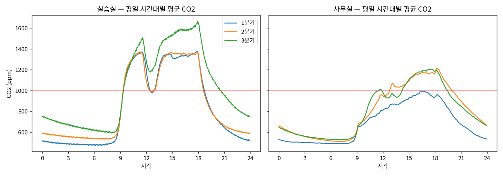

# 전기수 실데이터 — 분기별 60분 예측 비교

> 전기수가 교육장을 쓴 **2025-12 ~ 2026-09** 실데이터로, 분기마다 사용 패턴이 어떻게 달랐고 **60분 뒤 CO₂·온도를 얼마나 맞힐 수 있는지** 비교했다.
> 합성 데이터로 한 과제 2~3과 달리, 이 문서는 **실제 센서 기록**만 쓴다.

## 측정 조건

| 항목 | 값 |
|---|---|
| 데이터 | 운영진 InfluxDB에서 읽기 전용 토큰으로 이관한 과거 원본(Parquet), **실습실·사무실·회의실** CO₂·온도·습도 |
| 분기 | **1분기 2025-12 ~ 2026-03** / **2분기 2026-04 ~ 06** / **3분기 2026-07 ~ 09** (KST) |
| 전처리 | 과제 2와 같은 규칙: 범위 밖 값 제거, 재전송 중복 제거, **5분 격자**, 15분 이하 결측은 직전 값 채움. 같은 공간의 여러 센서는 평균(실습실 3~4대, 사무실·회의실 1대) |
| 모델 | 과제 3과 같은 GRU 구조. **실데이터에는 수업 시간표가 없어 일정 입력 없이** 과거 2시간 + 시각·요일 + 공간. 정규화는 각 실험의 학습 기간으로만 계산. **시드 2개 평균** |
| 평가 시점 | 시험 기간 중 현재값·5/15/30/60분 뒤 실제값(채운 값 제외)·기준선 입력이 모두 있는 5분 시점. 기준선 3종과 **같은 시점**에서 비교 |
| 보드 | Jetson Orin Nano Super 25W, **CPU 학습**(같은 보드의 서비스 보호를 위해 GPU 미사용) |

> ⚠️ **회의실은 예측 비교에서 빠졌다.** 회의실 센서는 10분마다 보내서 "5분 뒤 실제값"이 대부분 없다(채운 값). 사용 패턴(1절)에는 포함했다.

## 1. 분기별 사용 패턴 (평일 9~18시)

| 분기 | 공간 | 5분 칸 관측률 | 평균 CO₂ | **1,000ppm 초과 비율** | 하루 최고 CO₂ (중앙값) | 평균 온도 |
|---|---|---|---|---|---|---|
| 1분기 | 실습실 | 99.8% | 1,250 | **78.1%** | 1,512 | 22.2℃ |
| | 사무실 | 53.9% | 851 | 12.0% | 1,105 | 22.1℃ |
| | 회의실 | 99.6% | 1,058 | 38.3% | 1,790 | 16.3℃ |
| 2분기 | 실습실 | 82.0% | 1,252 | **66.3%** | 1,507 | 22.8℃ |
| | 사무실 | 82.0% | 992 | 37.7% | 1,331 | 22.7℃ |
| | 회의실 | 82.0% | 1,202 | 44.5% | 1,648 | 21.8℃ |
| 3분기 | 실습실 | 100% | **1,406** | **80.5%** | 1,696 | 23.0℃ |
| | 사무실 | 100% | 1,003 | 43.2% | 1,392 | 24.9℃ |
| | 회의실 | 100% | **1,563** | 66.3% | **2,718** | 24.5℃ |



*평일 시간대별 평균 CO₂. 빨간 선이 1,000ppm.*

- **실습실은 어느 분기든 수업 시간의 2/3 이상이 1,000ppm을 넘었다.** 9시에 수업이 시작되면 30분 만에 1,000ppm을 넘고, 점심(12~13시)에만 잠깐 내려온다.
- **3분기(여름)가 가장 나빴다.** 실습실 오후 평균이 1,600ppm까지 오르고, **밤새 CO₂가 600~750ppm으로 바깥 공기(약 420ppm)까지 내려가지 않는다**(1·2분기는 480~590ppm). 여름철 냉방 때문에 창문을 닫아 환기가 줄었거나, 센서 영점이 틀어졌을 가능성이 있다. 과제 4의 "새벽 기준선" 규칙이 바로 이런 경우를 잡도록 만든 것이다.
- 회의실은 3분기에 하루 최고 CO₂가 2,700ppm까지 올랐다. 작은 방(부피가 작음)이라 사람이 몰리면 금방 올라간다.
- 사무실 1분기 관측률이 54%인 것은 **2026년 2월 한 달 동안 CO₂ 센서가 멈췄기** 때문이다. 2분기 82%는 **5월 일부 기간에 세 공간 모두** 데이터가 비었기 때문이다.

## 2. 실험 설계

| 실험 | 학습 | 검증 | 시험 | 묻는 질문 |
|---|---|---|---|---|
| **A 1분기** | 12-01 ~ 02-23 | ~ 03-07 | **03-07 ~ 03-31** | 같은 분기 앞부분으로 뒷부분을 맞힐 수 있나 |
| **A 2분기** | 04-01 ~ 06-03 | ~ 06-12 | **06-12 ~ 06-30** | 〃 |
| **A 3분기** | 07-01 ~ 09-03 | ~ 09-12 | **09-12 ~ 09-30** | 〃 |
| **B 1분기 → 2분기** | 1분기 (마지막 10%는 검증) | | **2분기 전체** | 지난 분기로 학습해 **다음 분기**를 맞힐 수 있나 |
| **B 1·2분기 → 3분기** | 1·2분기 (마지막 10%는 검증) | | **3분기 전체** | 〃 (계절이 바뀔 때) |

시험 시점 수: A 분기마다 실습실 5,241~6,908 / 사무실 3,262~5,288, B는 공간마다 21,188~26,485.

## 3. 결과 — 60분 뒤 CO₂ 오차 (MAE, ppm)

| 실험 | 현재값 유지 | 최근 1시간 평균 | 어제 같은 시각 | **GRU** | **현재값 유지 대비** |
|---|---|---|---|---|---|
| A 1분기 | 83.7 | 108.9 | 171.5 | **53.7** | **−36%** ✅ |
| A 2분기 | 82.1 | 108.9 | 238.5 | **66.0** | −20% |
| A 3분기 | 54.0 | 69.2 | 202.6 | **50.6** | −6% |
| B 1분기 → 2분기 | 70.2 | 92.3 | 183.0 | **59.5** | −15% |
| B 1·2분기 → 3분기 | 81.7 | 106.7 | 234.8 | **74.5** | −9% |

✅ = 과제 3 기준(30% 이상 개선) 충족

### 공간별 (60분 CO₂, ppm — 현재값 유지 → GRU)

| 실험 | 실습실 | 사무실 |
|---|---|---|
| A 1분기 | 99.7 → **58.0 (−42%)** | 49.6 → 44.6 (−10%) |
| A 2분기 | 89.7 → 78.7 (−12%) | 74.5 → **53.4 (−28%)** |
| A 3분기 | 58.5 → 58.7 (0%) | 49.4 → 42.5 (−14%) |
| B 1분기 → 2분기 | 82.7 → **58.8 (−29%)** | 57.7 → 60.1 (**+4%, 더 나쁨**) |
| B 1·2분기 → 3분기 | 97.5 → 96.3 (−1%) | 65.8 → **52.7 (−20%)** |

### 예측 시점별 (CO₂, ppm — GRU / 현재값 유지)

| 실험 | 5분 | 15분 | 30분 | 60분 |
|---|---|---|---|---|
| A 1분기 | 13.6 / 16.8 | 21.4 / 29.6 | 32.9 / 47.3 | 53.7 / 83.7 |
| A 2분기 | 13.4 / 14.8 | 23.2 / 28.1 | 38.1 / 46.6 | 66.0 / 82.1 |
| A 3분기 | 12.6 / 13.3 | 19.4 / 21.6 | 29.0 / 32.1 | 50.6 / 54.0 |
| B 1분기 → 2분기 | 12.6 / 13.6 | 21.7 / 25.2 | 34.8 / 40.4 | 59.5 / 70.2 |
| B 1·2분기 → 3분기 | 13.9 / 15.3 | 24.5 / 28.4 | 41.3 / 46.6 | 74.5 / 81.7 |

### 온도 (60분 뒤, ℃ — GRU / 현재값 유지)

| A 1분기 | A 2분기 | A 3분기 | B 1분기 → 2분기 | B 1·2분기 → 3분기 |
|---|---|---|---|---|
| **0.27 / 0.43** | 0.19 / **0.17** | 0.13 / **0.11** | 0.34 / **0.20** | 0.25 / **0.21** |

## 4. 해석

**① 실데이터는 합성 데이터보다 훨씬 어렵다**
- 같은 GRU 구조가 합성 데이터에서는 현재값 유지보다 **60%** 좋았지만(과제 3), 실데이터에서는 **6~36%**에 그쳤다.
- 가장 큰 차이는 **수업 시간표가 없다**는 것이다. 합성 데이터에서 일정 정보만으로 오차가 26% 줄었는데(과제 3), 실데이터 모델은 "곧 수업이 시작된다"를 알 수 없어 시작 순간을 늦게 따라간다.
- 실제로는 기준선 자체도 더 크게 틀린다(현재값 유지 54~84ppm vs 합성 45ppm). 실제 교실은 쉬는 시간·창문 개방·출입이 불규칙하다.

**② 같은 분기 안에서는 쓸 만하지만, 분기마다 차이가 크다**
- 1분기는 **−36%로 기준(30%)을 넘었다.** 실습실은 −42%였다. 수업 패턴(9시 시작, 점심, 18시 종료)이 일정해서 시각·요일만으로 많이 배웠다.
- 3분기는 −6%에 그쳤고, 실습실은 기준선과 같았다. 3분기 시험 구간(9/12~30)에는 **추석 연휴(9/24~26)**가 들어 있어 평소와 다른 날이 섞였을 가능성이 있다(확인 필요). 또 3분기는 밤에도 CO₂가 높아(1절) 하루 모양이 다른 분기와 달랐다.

**③ 지난 분기로 다음 분기를 맞히면 효과가 줄어든다**
- 1분기로 학습해 2분기를 맞히면 −15%, 1·2분기로 3분기를 맞히면 −9%였다. 같은 분기 안(A)보다 작다.
- 특히 **온도는 다음 분기로 넘어가면 현재값 유지보다 나빠졌다**(2분기 0.34 vs 0.20℃). 겨울(난방)에 배운 온도 흐름이 봄·여름(냉방)과 다르기 때문이다. **계절이 바뀌면 다시 학습해야 한다.**
- 사무실은 1분기 2월 데이터가 비어서 학습 자료가 적었고, 1분기 → 2분기 예측이 오히려 4% 나빴다.

**④ "어제 같은 시각"은 실데이터에서 더 쓸모없다**
- 171~239ppm으로 다른 기준선의 2~3배였다. 주말, 휴강, 연휴 다음 날마다 크게 틀린다.

## 5. 다음에 할 일

| 할 일 | 기대 효과 |
|---|---|
| **전기수 수업 시간표·회의실 예약 자료 확보** | 합성 데이터에서 일정 정보가 오차를 26% 줄였다. 실데이터에서 가장 큰 개선 여지 |
| **분기(학기)마다 다시 학습**, 또는 최근 몇 주만으로 갱신 | 계절이 바뀌면 온도·CO₂ 흐름이 달라진다(③) |
| 공휴일·방학 표시를 입력에 추가 | 연휴·방학처럼 평소와 다른 날에 덜 틀릴 것으로 기대(②) |
| 센서별 예측 또는 센서 보정 | 지금은 여러 센서 평균이라 센서마다 다른 값(영점 차이)이 섞인다 |
| 3분기 실습실 야간 CO₂ 확인 | 환기 문제인지 센서 영점 틀어짐인지 현장 확인 |

## 재현

```bash
/srv/team/venv/bin/python /srv/team/cohort/cohort.py   # 결과: /srv/team/cohort/out/
```
코드: [`code/cohort/cohort.py`](../code/cohort/cohort.py) · 결과 표: 보드의 `/srv/team/cohort/out/cohort_results.csv`, `cohort_profile.csv`
